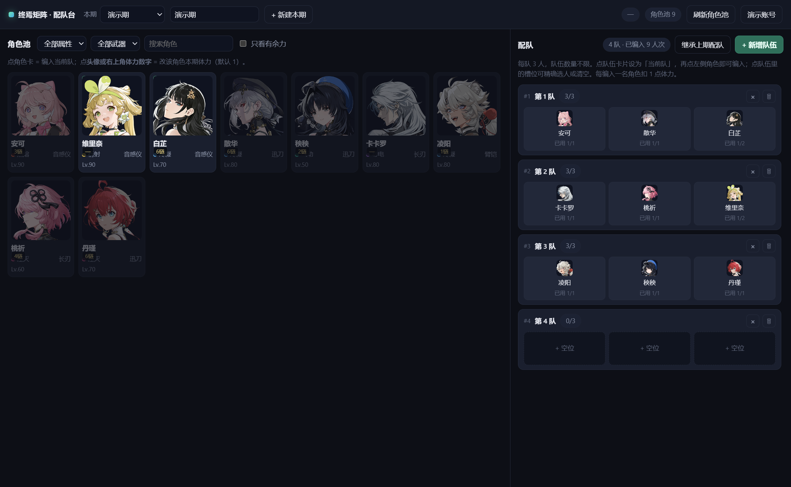
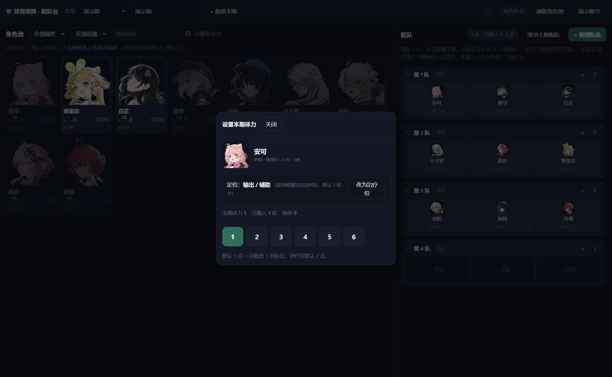
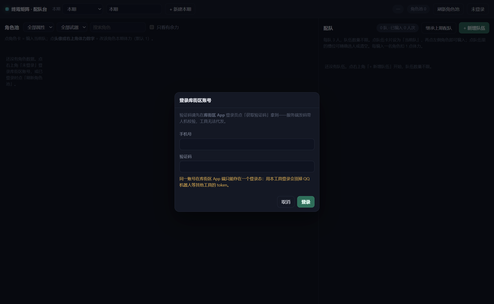

# 终焉矩阵 · 配队台

给《鸣潮》终焉矩阵用的**配队 / 体力管理**桌面工具。

解决的核心问题：**每期加成角色一换，上期配好的队伍就全废了。**

[](LICENSE)




---

## 它解决什么

终焉矩阵要消耗大量角色体力，而**每期的加成角色都在轮换**——上期辛苦配好的十几支队伍，
下期可能一半用不了。手动重配一次要十几分钟，而且很容易配到一半发现某个角色体力不够。

这个工具把这件事拆成三件可管理的事：

| 痛点 | 工具里的对应 |
| --- | --- |
| 角色体力就一点，要盯着别超 | 每张角色卡实时显示 **剩余/容量**；用尽的自动置灰、编不进去；编入次数超出体力时，队伍卡和角色卡同时标红 |
| 想配几个队就配几个队 | 队伍数量不限。点队伍卡片设为「当前队」，再点角色即编入 |
| 上期配好，下期全打乱 | **「导入配队」**：一个窗口里既能选上期配队，也能选**导出过的配队数据**；**体力不够的角色自动灰显**——只需改坏掉的那几个位置 |

<br>

## 功能

- **角色池** —— 自动从库街区拉取你账号拥有的全部角色：头像 / 属性 / 武器 / 等级 / 共鸣链
- **体力模型** —— 默认 **1 点**（只能进 1 支队伍）；判定为**治疗位**的角色默认 **2 点**；都能单独改
- **治疗位识别** —— 治疗角色卡片带绿色「治疗」标，自动按 2 体力算
- **配队窗口** —— 每队 3 人，队伍数量不限；**按住队伍卡片可上下拖动调整顺序**；编入次数超出角色体力时实时拦截，超支的角色灰显并在队伍里标出
- **导入配队** —— 一个窗口两组：**本机上一期**（一键搬过来，体力沿用当期）、**导出过的配队数据**（连体力设置一起还原）。导入时自己选「新建一期」还是「覆盖当前期」，默认新建一期，不动现有方案
- **配队数据导出** —— 「导出 / 分享」窗口里点 **保存配队数据**，存成一份 `.json`：队伍站位 + 该期体力/治疗判定 + 用到的角色名。可以发给别人、换机器、或当备份，**不含任何账号信息**
- **分享配队图** —— 点「导出 / 分享」把当前配队渲染成一张深色卡片（队伍 / 角色 / 余力 / 统计 + 页脚水印）。弹窗里点 **「截图并复制」** 直接进剪贴板，到 QQ / 微信里 Ctrl+V 就能发；也可以「保存 PNG」存到 `<数据目录>/exports/`。队伍多时自动切成紧凑多列布局，十几队也能一张装下
- **公告与版本核对** —— 顶栏右侧常显当前版本号。点开能看到**更新公告**（直接读本仓库的 GitHub Release），有新版本时按钮会变成高亮提示。启动时静默检查一次，结果缓存到本地
- **离线优先** —— 头像首次启动下载到本地缓存，之后不再重复请求；**配队 / 体力 / 导入导出 / 分享图全部离线可用**。唯一的外部请求是启动时静默检查一次更新公告，失败就当没有，不影响任何功能

### 改单个角色的体力

点角色卡的**头像**或**右上角体力数字**：



弹窗里可以快捷选 1–6 体力、一键恢复默认，也能纠正治疗位判定（写进当期，不影响其它期）。

---

## 运行

### 方式一：双击项目里的 `wuwa-matrix.exe`（最省事）

项目根目录里的 **`wuwa-matrix.exe`** 就是完整程序——免安装版，对应最近一次发版的构建。

两种拿法都行：`git clone https://github.com/lNeko-afk/Wuwa-Matrix.git`，
或者在仓库页面点 **Code → Download ZIP** 解压（ZIP 里已经带着这个 exe）。

然后**直接双击 `wuwa-matrix.exe`**。**不需要 Node.js、不需要 npm、不需要 `npm install`**——
Electron 运行时和应用代码全都打进了这一个 exe，可以随便挪到桌面或 U 盘。

想要**安装版**（装到用户目录、带开始菜单 / 桌面快捷方式、可从「应用和功能」卸载）：
去 [**Releases**](https://github.com/lNeko-afk/Wuwa-Matrix/releases) 下带版本号的
`wuwa-matrix-x.y.z-setup-x64.exe`。

> ⚠️ 本项目没有购买代码签名证书，首次运行 Windows SmartScreen 会拦一下：
> 点 **「更多信息」→「仍要运行」** 即可。

### 方式二：直接跑源码

需要 **Node.js 20+**。

```bash
git clone https://github.com/lNeko-afk/Wuwa-Matrix.git
cd Wuwa-Matrix
npm install
npm start
```

Windows 上也可以直接双击 **`启动配队台.bat`**（等价于 `npm start`）。
首次运行它会检查 Electron 运行时，缺失时会**问你要不要直接执行 `npm install`**——
同意即可，装完自动启动（前提是本机已装 Node.js 20+）。

### 方式三：自己打包 exe

```bash
npm run dist
```

产物在 `dist/`：

- `wuwa-matrix-<版本>-setup-x64.exe` —— NSIS 安装包（用于上传 Releases）
- `wuwa-matrix-<版本>-portable-x64.exe` —— 免安装单文件（用于上传 Releases）
- `win-unpacked/` —— 未压缩的目录版，中间产物

打包结束后，免安装版会被**自动复制到项目根目录的 `wuwa-matrix.exe`**（固定文件名，
所以仓库工作区里始终只有一份，也就是「方式一」里让人双击的那个）。
想连安装版一起放到根目录，用 `WUWA_ROOT_SETUP=1 npm run dist`。

打包不会去 GitHub 下载 Electron：配置里写了 `electronDist: node_modules/electron/dist`，
直接复用 `npm install` 已经装好的那份。

`npm run dist` 实际调的是 **`scripts/dist.mjs`**，它替你先做了三件在 Windows 上很容易卡住的事：

| 它做的事 | 为什么 |
| --- | --- |
| 缓存固定到工程内 `.eb-cache/` | 默认缓存在 `%LOCALAPPDATA%`（C 盘），被系统清理后就得重下 |
| 二进制默认走 npmmirror | electron-builder 还要下 `nsis` / `7zip`，默认走 github.com，国内常 `ECONNRESET` |
| 预解压 `winCodeSign` 并排除 `darwin`/`linux` | 包里有 macOS 用的符号链接，而 Windows 建符号链接需要管理员权限或开发者模式，7za 会直接报 `Cannot create symbolic link ... 客户端没有所需的特权` |

想换镜像或换缓存位置，用环境变量 `ELECTRON_BUILDER_BINARIES_MIRROR` /
`ELECTRON_BUILDER_CACHE` 覆盖即可。

应用图标由 `npm run icon` 生成（`scripts/make-icon.mjs`，零依赖手写 PNG/ICO 编码），
`npm run dist` 会先跑它。本项目刻意设置 **`asar: false`**：exe 只作为入口，
源码就是旁边可读的文件，不打成不可查看的黑盒。

打包体积：安装包 / 免安装版各约 **78 MB**（解压后约 268 MB，其中绝大部分是 Electron 运行时；
应用代码本身只有 0.1 MB，且**没有任何运行时 npm 依赖**）。

---

## 使用

### 1. 登录

首次启动会要求登录**库街区账号**（手机号 + 短信验证码）：



**两种拿验证码的方式，任选：**

- **点工具里的「发送验证码」** —— 会弹出一个小窗口过人机校验，划一下通过后自动把短信发到你手机，**手机上不用再输一遍号码**。
- **在库街区 App 里点「获取验证码」** —— 拿到 6 位数填进工具即可。

登录过一次之后，工具会**记住手机号**（加密存储），之后只需要输验证码。

> ⚠️ **登录会让其它库街区客户端掉线** —— 库街区 App、微信里的鸣潮小工具、岸宝机器人等 QQ 机器人，
> 之后各自都需要重新登录。详见下方「常见问题」。

### 2. 如果拉取角色时报「角色数据未开放展示」

去库街区 App 的数据终端里把**对外展示**开关打开。

### 3. 配队

1. 点「+ 新增队伍」
2. 点队伍卡片把它设为「当前队」（高亮）
3. 点左侧角色即编入；也可点具体槽位精确选人或清空
4. 新一期：点「+ 新建本期」；或者点「导入配队」，选上期配队或某份导出过的配队数据

### 4. 分享配队 / 换机器

配队区顶部的 **导出 / 分享** 按钮，打开后窗口里有两个保存按钮：

| 按钮 | 产物 | 用途 |
| --- | --- | --- |
| 保存配队数据 | `<数据目录>/exports/配队-<期名>-<时间>.json` | 换机器、备份、发给朋友 |
| 保存 PNG | 同目录下的图片 | 发群、发动态 |

想把配队给别人：先点「打开文件夹」把那份 `.json` 拷出来发过去。
对方把它丢进自己的同一个文件夹，点 **导入配队** →「重新扫描」，列表里就会出现，选中即可导入。

导入时选 **新建一期**（默认，不动现有方案）或 **覆盖当前期**。体力不够的角色会**灰显**（队伍里也会写谁超支），换掉就行 —— 导入不会因为体力不够而失败。

---

## 数据与隐私

工具需要用到你的库街区账号，所以这里把安全设计讲清楚：

| 事项 | 做法 |
| --- | --- |
| **凭据加密落盘** | token / did / **手机号** 都用 Electron `safeStorage` 加密后存储（Windows 上底层是 **DPAPI**，密钥绑定当前操作系统账户）。文件被拷到别的机器或别的用户下**解不开**，会当作未登录 |
| **凭据不进入界面进程** | token 只存在于 Electron 主进程。发给页面的配置里**根本没有** `credentials` 字段，页面即使被注入也拿不到凭据 |
| **手机号不进界面进程** | 界面只显示打码值（如 `138****0000`）；登录时渲染层**只回传验证码**，完整号码由主进程补上 |
| **凭据不出现在仓库** | 数据目录 `.data/` 已在 `.gitignore` 中；仓库里不含任何账号数据、也不含游戏素材 |
| **头像不入库** | 角色头像运行时从官方 CDN 下载到 `.data/icons/` 本地缓存；仓库不分发任何游戏美术资源 |
| **对外只连两处** | 就只有角色头像 CDN（下载头像到本地缓存）和 `api.github.com`（读本仓库的 Release 列表，用于更新公告）。两者都是**只读**，不带账号信息、不带使用统计，也没有任何上报接口。公告请求失败时静默跳过 |
| **导出的配队数据不含账号信息** | `exports/` 里的 `.json` 只有队伍站位、角色 id / 名字和该期的体力设置 —— **没有特征码、没有手机号、没有 token**，可以放心发给别人 |
| **人机校验脚本被隔离** | 「发送验证码」用的极验控件跑在一个**独立的空窗口**里 —— 那里面没有任何应用数据、也没有输入框。主界面仍是 `file://` 加载，CSP 不放行任何第三方域名。即使那个第三方脚本被劫持，也拿不到 token，最坏只能触发一次发码尝试 |
| **调试钩子不可用** | 截图/注入类调试开关只在未打包的开发态生效，且注入任意 JS 需要额外显式打开第二个开关 |

数据目录：

| 运行方式 | 位置 |
| --- | --- |
| 源码运行 | 项目目录下的 `.data/`（便携，方便备份和检查） |
| 安装版 / 免安装版 | `%APPDATA%\wuwa-matrix\data`（安装目录不一定有写权限，所以数据不放那儿） |

两种情况都可以用环境变量 `WUWA_DATA_DIR` 指到别处（例如 U 盘）。

> ⚠️ 备份或分享 `.data/` 前请注意：里面除了加密的凭据，还有你的**角色池和配队方案**。
> 凭据本身因加密而无法在别人机器上解密，但角色池属于你的账号信息。

---

## 版本核对

这个项目的**源码是公开的**。任何人都能改一份、自己编译成 exe，再做成看起来一样的安装包传出去。
所以「你手上这个是不是官方发布的」需要能核对，而不是靠界面长得一样。

工具里点顶栏右侧的版本按钮（`v0.2.0`），公告弹窗顶部会显示当前版本：

- **源码运行**时显示 `v0.2.0 · 421bf3a` —— 点后面那 7 位就是构建时的 commit 短哈希，可以直接在
  [提交历史](https://github.com/lNeko-afk/Wuwa-Matrix/commits/main) 里查到这个确切的版本。
- **打包后的 exe** 里没有 `.git`，所以只显示版本号。打包版的核对请走下面的 SHA-256。

### 核对安装包

每次发版都会把安装包的 SHA-256 一起上传成 `SHA256SUMS.txt`。自己算一遍比对（Windows 自带工具，
不用装任何东西）：

```bat
certutil -hashfile wuwa-matrix-0.2.0-setup-x64.exe SHA256
```

把输出的那串十六进制，和 Release 里 `SHA256SUMS.txt` 对应行**逐字符对比**：
一致才说明文件没有被换过；不一致请删掉它，回到 [Releases](https://github.com/lNeko-afk/Wuwa-Matrix/releases)
重新下载。

> ⚠️ 作者**只在本仓库的 Releases 页发布构建产物**。从网盘、群文件、聚合站、二次搬运视频的
> 评论区或简介里拿到的 exe，都不受本项目的任何保证约束 —— 那些不是官方发布。

> 说明一下它能证明什么：**版本号和哈希都挡不住有心人**（改代码的人当然也能把界面改成任意样子）。
> 它们的用处是**举证**——被人改装冒充发布时，你能明确说出「官方那一份的版本和哈希是这个，
> 你手上那个对不上」。这才是要拿出手的东西。

---

## 已知限制

- **矩阵的角色体力没有任何接口能拿到**。作者扫过库街区全部游戏数据接口
  （`challengeDetails` / `towerData` / `calabash` / `explore` / `dailyData`），
  全库检索 `矩阵|体力|matrix|stamina` **零命中**。所以体力只能按
  「默认 1 / 治疗位 2」推断，个别不对就点开头像改，当期会记住。
- **治疗位判定按「固有突破属性含治疗效果加成」定义**，覆盖的是专职奶妈。
  以护盾/增益为主、没有治疗突破属性的辅助不会被自动标出——手动改一次即可。
- **主角（漂泊者）不参与判定，体力固定 1 点**：主角可以在多个属性间自由切换，
  按属性去猜会导致判定随切属性跳动。
- 只在 **Windows** 上实测过。macOS / Linux 理论上能跑（Electron 跨平台），但未验证。
- 目前是 **0.2.0**，功能以「配队 + 体力 + 跨期导入导出」为主；推荐配队尚未实现。

---

## 常见问题

**Q: 登录后我别的工具用不了了？**

库街区账号**同一时间只能有一个登录态**。用本工具登录，会让下面这些已经登录的客户端**全部掉线**，
各自都需要重新登录：

- **库街区 App** 本身
- **微信里的鸣潮小工具**（小程序 / 公众号类）
- **各种 QQ 机器人**，例如岸宝机器人
- 其它任何需要登录库街区的第三方工具

反过来也一样：你在别处重新登录，本工具的凭据同样会失效——在工具里再登一次即可，
**配队数据不会丢**。

**Q: 体力为什么不自动读取？**
见上方「已知限制」——游戏没有开放这个数据。

**Q: 为什么有些角色显示成首字方块？**
角色头像从官方 CDN 下载。首次启动或断网时会退化为首字占位，点「刷新角色池」或联网后重开即可。

---

## 开发

```bash
npm install
npm start                 # 启动
npm run verify            # 端到端校验：凭据可用 / 接口通 / 角色池字段完整
npm run mock              # 用自己的账号数据生成离线预览数据（不提交）
npm test                  # 治疗位判定的自测（无需账号与网络）
npm run icon              # 重新生成应用图标（build/icon.png + icon.ico）
npm run dist              # 打包 exe（图标 → 打包 → 生成 dist/SHA256SUMS.txt）
```

想核对「这份凭据确实是我本人的账号」，用环境变量传入期望值（这样账号标识不会进仓库）：

```bash
WUWA_EXPECT_ROLE_ID=<特征码> WUWA_EXPECT_ROLE_NAME=<角色名> WUWA_EXPECT_ROLE_COUNT=34 npm run verify
```

### 目录结构

```
wuwa-matrix.exe                免安装版程序本体（由 npm run dist 生成到根目录，固定文件名）
启动配队台.bat                 源码启动脚本（等价于 npm start）
src/main/kurobbs.cjs           库街区 API 客户端（零依赖：短信登录 → b-at → 角色列表 → 发码）
src/main/store.cjs             本地 JSON 存储（负责凭据 / 手机号的加密）
src/main/main.cjs              Electron 主进程 + IPC + 头像缓存 + 人机校验小窗
src/main/preload.cjs           contextBridge 暴露面
src/main/captcha-preload.cjs   人机校验小窗的 preload（只暴露「通过 / 取消」）
src/captcha/                   人机校验页：在隔离小窗里以 http://127.0.0.1 加载
src/renderer/app.js            界面逻辑（体力模型 / 配队 / 导入导出）
src/renderer/healers.js        治疗位名单（数据，由脚本生成）
src/renderer/mock.js           合成演示数据（离线预览 / 截图用，与任何真实账号无关）
scripts/make-mock.mjs          用本机真实数据生成预览数据
scripts/classify-healers.mjs   重新生成治疗位名单（无需登录）
scripts/test-healers.cjs       治疗位判定的自测（无需账号与网络）
scripts/make-icon.mjs          生成应用图标（零依赖手写 PNG/ICO）
scripts/dist.mjs               打包入口（固定缓存/镜像，预解压 winCodeSign）
scripts/make-checksums.mjs     打包后生成 dist/SHA256SUMS.txt（发版时一起上传）
scripts/verify.cjs             端到端校验
build/icon.png|ico             应用图标（由 make-icon.mjs 生成，进仓库）
```

### 离线预览界面

不登录也能看界面：直接用浏览器打开 `src/renderer/index.html`，
会加载 `mock.js` 里的合成演示数据并进入预览模式。

### 调试开关（仅开发态）

| 变量 | 作用 |
| --- | --- |
| `WUWA_DATA_DIR` | 覆盖数据目录 |
| `WUWA_CAPTURE` | 页面加载后自动截图并退出（填入 PNG 路径） |
| `WUWA_CAPTURE_JS` | 截图前注入一段 JS（模拟点击），需同时设 `WUWA_ALLOW_JS_HOOK=1` |

### 重新生成治疗位名单

游戏出新角色后重跑一次分类脚本（库街区 Wiki 接口**无需登录**）：

```bash
node scripts/classify-healers.mjs          # 仅打印结果
node scripts/classify-healers.mjs --write  # 直接更新 src/renderer/healers.js
```

---

## 免责声明

- 本项目是**非官方**的第三方工具，与库洛游戏（Kuro Games）**没有任何关系**，也未获其授权或认可。
- 工具通过库街区的非公开接口读取**你自己账号**的数据。使用此类接口可能违反游戏的用户协议，
  **由此产生的任何后果由使用者自行承担**。
- 本项目**不包含、也不分发**任何游戏美术资源、音频或文本素材。界面中的角色头像由使用者的
  客户端在运行时从其官方 CDN 缓存到本地，仅用于展示使用者自己的账号数据。
- 本项目按原样提供，不对可用性、数据准确性作任何担保。

## 致谢

接口行为与数据结构的摸索，参考了这些社区项目（**仅参考其公开行为，未复制其代码**）：

- [Kuro-API-Collection](https://github.com/TomyJan/Kuro-API-Collection) —— 库街区 API 接口文档
- [WutheringWavesUID](https://github.com/tyql688/WutheringWavesUID) —— 鸣潮 UID 查询机器人
- [wuthering-waves-platform](https://github.com/yangfeng20/wuthering-waves-platform) —— 鸣潮个人数据平台
- [erzaozi/waves-plugin](https://github.com/erzaozi/waves-plugin) —— 上述项目共同的上游

## 许可

[AGPL-3.0-only](LICENSE)
